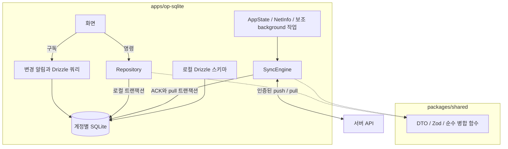
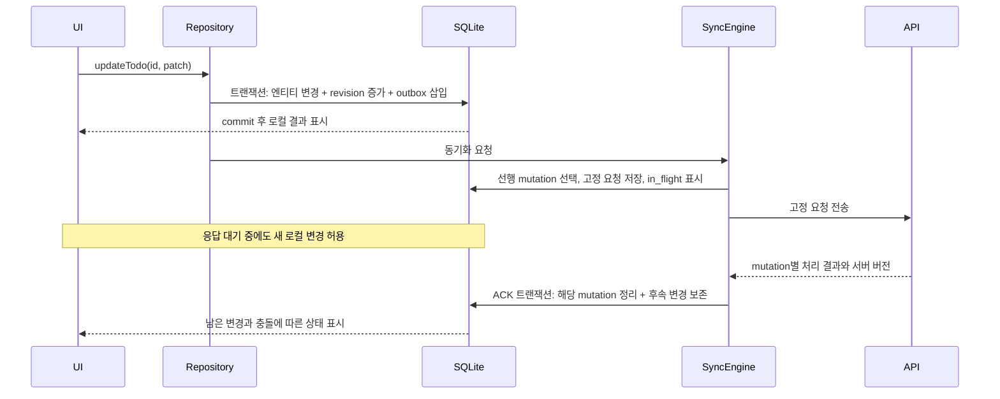

# 로컬 데이터베이스 설계: OP-SQLite

> 최신 구현 상태: 사용자 요청에 따라 `apps/watermelon`과 `apps/op-sqlite` 두 앱을 병행 구성했다. 공통 UI와 Zustand 상태관리는 `packages/todo-app`, Todo 타입과 Repository 계약은 `packages/shared`에 있다. Fastify + PostgreSQL 자체 서버와 양쪽 앱의 수동 서버 저장·복원을 구현했다. Watermelon 기본 계약과 OP 자체 outbox 계약을 병행한다. 실제 동기화 범위·단일 사용자 인증·운영 제한은 [동기화 서버](sync-server.md)를 따른다. Drizzle/MMKV/Keychain은 설치하지 않았다. 아래 추천·대체 경로와 동기화 계약은 설계 검토 기록이며 실제 설치·실행 범위는 [README](../README.md)를 따른다.

- 상태: 대안 (Fallback). WatermelonDB가 1차 추천이며, 이 문서는 경로 A(계약 유지)와 경로 B(자체 계약)를 구분한다. 본문의 상세 SyncEngine 설계는 경로 B에 해당한다.
- 작성일 / 검토 반영일: 2026-10-13
- 대상: `apps/op-sqlite` (React Native 0.87.1, Community CLI bare 앱), `packages/shared`
- 관련 문서: [기술 스택 비교 및 추천](technology-stack-recommendation.md)

## 1. 배경과 선택의 전제

이 앱은 네트워크 없이 Todo를 조회·추가·수정·완료·삭제할 수 있어야 한다. 화면은 로컬 DB를 읽고, 로컬 트랜잭션이 완료되면 저장 결과를 즉시 표시한다. 서버 저장 완료는 별도 동기화 상태로 표시한다.

서버는 직접 운영한다(2026-10-13 확정). 환경 문제를 해결한 뒤에도 WatermelonDB의 네이티브 호환성 문제가 확인되면 **경로 A: WatermelonDB 계약을 유지하는 OP-SQLite 클라이언트**를 기본 대안으로 검토한다. 이 경로도 변경 추적과 클라이언트 동기화 로직을 직접 구현해야 한다.

**경로 B: 자체 SyncEngine**은 mutation별 ACK와 명시적 충돌 보존이 필요한 경우의 별도 선택이다. 이 문서의 4~9장과 mutation별 테스트는 경로 B를 구체화하며, 경로 A의 완성된 구현 명세가 아니다. 서버가 아직 없다는 이유만으로 경로 B로 전환하지 않는다. 경로별 선택 조건은 [기술 스택 문서 1.1절](technology-stack-recommendation.md)을 따른다.

OP-SQLite + Drizzle은 SQL과 데이터 모델을 직접 통제하기 위한 후보이다. 기존 WatermelonDB 추천안보다 변경 추적·충돌·복구 로직을 더 많이 구현해야 한다. 이 비용을 감수하고 아래 검증 기준을 통과하는 것을 채택 조건으로 삼는다. 문서 수정은 패키지 설치나 RN 0.87.1 호환성 검증 완료를 의미하지 않는다.

## 2. 경로 B의 구성 제안

- **OP-SQLite**: 로컬 SQLite 접근, 트랜잭션, 변경 알림.
- **Drizzle ORM**: 로컬 쿼리와 스키마·마이그레이션 관리. 실제 사용할 버전 조합의 트랜잭션 동작을 검증한다.
- **자체 SyncEngine**: Outbox 기반 전송, 증분 수신, 충돌 처리와 복구.
- **MMKV**: 사용자 설정 등 DB와 원자적으로 변경할 필요가 없는 작은 값만 저장한다.
- **Keychain/Keystore**: 인증 토큰과 필요한 경우 DB 암호화 키를 저장한다.
- **SQLite `sync_meta`**: pull 커서, 동기화 계약 버전과 마지막 성공 상태를 저장한다. 커서는 MMKV에 두지 않는다.

## 3. 선정 이유와 대안

| 기준 | 판단 | 검증 및 제약 |
| --- | --- | --- |
| bare CLI | Expo Modules를 추가하지 않고 SQLite를 사용할 수 있다 | 실제 iOS/Android 빌드로 확인 |
| SQL 제어 | 관계형 조회, 필터, 정렬과 인덱스를 직접 설계할 수 있다 | Todo 규모의 실제 쿼리로 검증 |
| 트랜잭션 | 엔티티와 outbox를 한 번에 커밋할 수 있는 기반을 제공한다 | Drizzle과 네이티브 트랜잭션의 연결을 검증해야 함 |
| 성능 | 네이티브 SQLite 접근과 배치 실행을 활용할 수 있다 | 대량 upsert 우위는 측정 전 단정하지 않음 |
| 반응형 조회 | DB 변경 알림을 UI 갱신에 연결할 수 있다 | commit·rollback·join 의존성 처리 확인 |
| 암호화 | SQLCipher 구성을 검토할 수 있다 | 빌드 옵션과 키 복구 정책 확인 |
| 이식성 | SQLite 도구를 사용할 수 있다 | SQLCipher 파일은 키와 호환 도구 필요, 확장 기능은 빌드별 확인 |

OP-SQLite는 트랜잭션과 배치 API를 제공하며 Drizzle에는 OP-SQLite 드라이버가 있다. API 존재만으로 두 라이브러리의 특정 버전 조합이 안전하게 동작한다고 가정하지 않는다. [OP-SQLite API](https://op-engineering.github.io/op-sqlite/docs/api/), [Drizzle OP-SQLite](https://orm.drizzle.team/docs/sqlite/connect-op-sqlite)

| 후보 | 이번 제안과의 차이 |
| --- | --- |
| Expo SQLite | 충분한 후보지만 bare CLI 프로젝트에 Expo Modules 구성이 추가된다 |
| WatermelonDB | 모델·쿼리 API를 수용하면 변경 추적과 동기화 프로토콜 구현 부담을 줄인다. 유지보수 속도에 대한 근거 없는 평가는 선정 이유에서 제외한다 |
| Firestore 네이티브 SDK | 빠른 출시를 위한 대안. 자체 SQLite와 함께 사용하면 두 저장소 사이의 동기화 책임이 추가된다 |
| Realm | 로컬 DB로서의 장점과 서버 동기화 제공 여부를 분리해 평가한다. 이번 안은 SQL과 SQLite 도구 활용을 우선한다 |
| MMKV / AsyncStorage 단독 | 관계형 도메인 데이터와 outbox의 원자적 저장을 위한 주 DB로 선택하지 않는다 |
| PowerSync | 직접 동기화 구현 부담이 커지면 재검토한다. SQLite를 사용한다는 이유만으로 기존 스키마·쓰기 경로·outbox를 그대로 이전할 수 있다고 가정하지 않는다 |

이 문서는 OP-SQLite 후보를 구체화한다. 다른 후보의 특성과 공식 출처는 [기술 스택 비교 문서](technology-stack-recommendation.md)를 참고한다.

## 4. 아키텍처와 책임

| 계층 | 책임 |
| --- | --- |
| UI / Query | 로컬 데이터 구독, 사용자 명령, 저장·동기화·충돌 상태 표시 |
| Repository | 엔티티 변경, 로컬 revision 증가, outbox 삽입을 같은 트랜잭션으로 실행 |
| DB adapter | 하나의 명시적인 트랜잭션 경계와 commit 후 변경 알림 제공 |
| SyncEngine | 계정별 직렬 실행, 요청 고정, ACK 처리, pull, 충돌과 재시도 |
| shared | 플랫폼 독립 DTO, 런타임 검증, 순수 도메인·병합 함수 |
| 서버 API | 사용자 권한, 원자적 버전 검사와 쓰기, 멱등성 결과, 일관된 변경 스트림 |

SQLite 테이블 정의는 모바일에 둔다. 서버가 PostgreSQL 또는 Firestore이면 서버용 모델은 별도로 정의한다. 공통 DTO와 검증 규칙을 공유하며 DB 스키마 자체가 모든 백엔드에서 재사용된다고 가정하지 않는다.

## 5. 저장 모델

다음은 논리 스키마 초안이다. 실제 DDL에는 필요한 `NOT NULL`, `UNIQUE`, `CHECK`, 인덱스를 선언한다. TypeScript enum만으로 DB의 값 제약이 생긴다고 가정하지 않는다.

### 5.1 도메인 엔티티

| 컬럼 | 의미 |
| --- | --- |
| `id` | 오프라인 생성 UUID. UUIDv7의 시각 부분을 인과관계나 동기화 순서로 사용하지 않음 |
| `created_at`, `updated_at` | 로컬 표시·기록용 시각. 충돌의 승자 판단에 사용하지 않음 |
| `local_revision` | 같은 엔티티의 로컬 명령마다 증가하는 정수 |
| `server_version` | 마지막으로 확인한 서버 버전. 신규 로컬 엔티티는 NULL |
| `deleted_at` | 삭제 표시. 삭제 전파 완료 전 물리 삭제 금지 |
| `sync_status` | `synced`, `pending`, `conflict`, `error`. outbox·충돌 상태에서 계산하거나 같은 트랜잭션으로 갱신 |

### 5.2 Outbox

| 컬럼 | 의미 |
| --- | --- |
| `local_seq` | SQLite에서 트랜잭션 안에 할당하는 증가 순번. 전송 의존 순서 기준 |
| `mutation_id` | UNIQUE 멱등성 키. 서버는 사용자 범위와 함께 식별 |
| `entity`, `entity_id` | 허용된 엔티티 종류와 ID |
| `op` | `create`, `patch`, `delete` 등 계약에서 허용하는 연산 |
| `patch` | 변경한 필드와 값. 서버 관리 필드는 제외 |
| `base_snapshot` | 3-way merge에 필요한 편집 기준값 또는 해당 기준을 복구할 수 있는 정보 |
| `base_version` | 편집 기준 서버 버전. 최신 조회 버전으로 단순 교체 금지. 선행 로컬 ACK 반영 또는 명시적 병합을 거친 queued 변경만 기준 조정 |
| `local_revision` | 이 명령이 만든 로컬 revision |
| `status` | `queued`, `in_flight`, `conflict`, `dead` |
| `request_payload` | 최초 전송 전에 영속화하는 고정 요청. 재시도 동안 동일하게 유지 |
| `attempts`, `next_attempt_at`, `last_error` | 재시도와 운영 진단 정보 |

DB는 계정별로 분리한다. 요청과 응답에는 계정 및 세션 세대를 연결하여 다른 계정 DB에 적용되지 않게 한다.

`base_snapshot`과 `base_version`은 일치하는 편집 기준을 보존한다. 원격 변경을 조회했다는 이유만으로 전송 직전에 최신 버전을 넣지 않는다. 선행 로컬 변경의 ACK를 반영하거나 원격 변경과 명시적으로 병합할 때만 queued 명령의 기준과 snapshot을 함께 조정한다. 충돌이 남으면 전송을 중단한다. `in_flight` 요청은 이 조정 대상에서 제외한다.

처음에는 coalescing 없이 명령을 보존한다. 동일 엔티티는 한 번에 하나만 전송하고, 후속 명령은 선행 결과가 확정된 후 처리한다. 서로 다른 엔티티라도 부모 생성 등 참조 의존성이 있으면 그 순서를 지킨다.

### 5.3 동기화·충돌 메타데이터

- `sync_meta`: 동기화 범위별 opaque 커서, `sync_epoch`, 계약 버전, 마지막 성공 시각. 서버 버전과 pull 커서는 서로 다른 개념이다.
- `sync_conflicts`: 엔티티 ID, 관련 mutation, base/local/remote 값, 원격 버전, 충돌 필드, 해결 상태.
- 페이지의 수신 변경, 충돌 기록, 커서 이동은 **하나의 SQLite 트랜잭션**으로 커밋한다.
- 충돌을 기록해 커서를 전진시키는 경우에도 원격 값과 로컬 의도가 영속적으로 남아 있어야 한다.

## 6. 로컬 쓰기와 ACK 처리

ACK 적용 규칙:

1. 응답의 계정·세션 세대와 `mutation_id`를 확인한다. 이전 세션의 응답은 새 DB에 적용하지 않는다.
2. 성공한 **해당 mutation만** 정리한다. 엔티티 전체 outbox를 삭제하지 않는다.
3. 응답의 서버 상태를 기준으로 아직 전송하지 않은 후속 patch를 순서대로 rebase/replay한다. 새 로컬 편집을 응답 값으로 덮어쓰지 않는다.
4. 서버 버전 갱신, 해당 mutation 정리, 후속 명령의 기준 조정과 화면용 상태 갱신을 같은 트랜잭션에서 수행한다.
5. 미처리 mutation·충돌·영구 오류가 없을 때만 `synced`로 표시한다. 단일 실행 락은 UI 쓰기를 막지 않으므로 ACK 트랜잭션에서 현재 revision과 큐를 다시 확인한다.

예: 서버 v10에서 A와 B를 연속 편집한 경우 A만 먼저 보낸다. A가 v11로 승인되면 queued B의 기준을 v11로 조정한 뒤 보낸다. B를 이전 v10으로 보내 자기 변경과 충돌시키지 않는다.

응답 유실이나 앱 종료로 결과를 모르면 기존 `mutation_id`와 고정 요청을 그대로 재전송한다. 이미 전송한 요청의 payload/baseVersion을 바꾸지 않는다. 명시적 충돌로 종료된 요청을 병합해 다시 보내는 경우에는 새로운 mutation ID를 만들고 기존 충돌과의 연결을 남긴다.

### 6.1 트랜잭션 구현 경계

Repository에는 단순 Drizzle 인스턴스 대신 `runInTransaction`과 그 안에서 사용할 트랜잭션 전용 쿼리 인터페이스를 주입한다. 실제 adapter 구현은 선택한 OP-SQLite/Drizzle 버전에서 검증한다.

원시 OP-SQLite 트랜잭션 내부에서 전역 Drizzle 인스턴스를 임의로 호출하지 않는다. 모든 쿼리가 같은 연결과 잠금 범위에 속하고, 비동기 콜백 완료까지 기다린 뒤 commit하며, 예외가 rollback되는지를 증명해야 한다. Node의 동기식 `better-sqlite3` 테스트로 이를 대체하지 않는다. [OP-SQLite 트랜잭션 API](https://op-engineering.github.io/op-sqlite/docs/api/), [Drizzle OP-SQLite 구현](https://github.com/drizzle-team/drizzle-orm/blob/main/drizzle-orm/src/op-sqlite/session.ts)

## 7. 동기화 프로토콜

### 7.1 실행과 재시도

- 앱 시작·foreground 복귀, 네트워크 복구, 로컬 쓰기 후 debounce, 수동 새로고침으로 실행한다. Background 작업은 보조 수단이며 실행 시점을 보장하지 않는다.
- 계정별 단일 실행 락과 로컬 순번을 사용한다. 같은 엔티티의 미확정 요청을 건너뛰고 후속 요청을 보내지 않는다.
- 한 사이클에서 처리할 push 양을 제한한 뒤 pull하여 계속되는 로컬 쓰기가 원격 변경 수신을 막지 않게 한다. Push 우선은 충돌 방지 보장이 아니며, 명시적 충돌 시 원격 상태 확인·해결 단계로 전환한다.
- 일시적 네트워크 오류, timeout, 재시도 가능한 서버 오류는 backoff+jitter로 재시도한다. 횟수만으로 `dead` 처리하지 않는다.
- 인증 만료는 갱신/재로그인까지 대기한다. 영구적인 검증 오류는 `dead`, 버전 충돌은 `conflict`로 보존한다. 화면에서 복구 또는 명시적 폐기를 제공한다.
- 한 엔티티의 오류가 다른 독립 엔티티의 동기화나 pull을 막지 않도록 한다.

### 7.2 서버 push 계약

- 서버가 인증 토큰에서 사용자를 결정하고 모든 엔티티 접근 권한을 검사한다.
- `mutation_id`만 전송한다고 멱등성이 생기지 않는다. 서버는 사용자별 처리 기록과 요청 fingerprint를 저장한다.
- 중복 요청은 버전 검사보다 먼저 처리 기록을 확인하여 동일한 결과를 반환한다. 같은 ID에 다른 요청 본문이 오면 거부한다.
- 버전 비교, 엔티티 쓰기, 변경 스트림 기록, 멱등성 성공 결과 저장은 같은 서버 트랜잭션으로 처리한다.
- 배치는 mutation별 결과를 반환하며, 초기 계약은 mutation별 원자성을 보장한다. 여러 엔티티를 한 번에 변경하는 도메인 명령은 별도 원자적 명령 계약을 정의한다.
- 결과에는 `mutation_id`, `applied/conflict/rejected`, 서버 버전과 병합에 필요한 서버 상태를 포함한다.
- 멱등성 기록 보존 기간과 지원하는 오프라인 기간을 맞춘다. 기록이 만료된 요청은 무조건 다시 실행하지 않고 재조정 절차를 거친다.

### 7.3 pull·삭제·복원 계약

- 서버가 발급한 opaque 커서와 안정적인 페이지 경계를 사용한다. 커서의 범위에는 사용자, 구독 범위와 `sync_epoch`가 포함된다. 모든 push도 epoch를 전달하며, 서버는 쓰기 전에 epoch를 검증한다.
- 동시 commit이 있어도 변경이 빠지지 않는 snapshot/변경 로그 경계를 정의한다. 단순 시각 또는 sequence 할당 순서를 commit 순서로 가정하지 않는다.
- `changes`, `nextCursor`, `hasMore`를 반환하며 클라이언트는 페이지 데이터와 `nextCursor`를 함께 커밋한다. 중간 종료 후 같은 페이지 재적용이 안전해야 한다.
- 이미 ACK로 확인한 서버 버전보다 오래된 pull 이벤트는 엔티티를 되돌리지 않는다. 비교 가능한 엔티티 버전과 이벤트 순서 규칙을 계약에 둔다.
- 서버 삭제는 tombstone으로 전달한다. 보존 기간을 넘긴 커서는 명시적으로 만료 처리하고 전체 재동기화한다.
- 최초 복원은 로그인 후 서버의 접근 가능한 현재 상태를 일관된 snapshot으로 받는다. 기존 DB 재동기화는 별도 staging 데이터에 snapshot을 구성하고 미동기화 명령·충돌을 보존·재조정한 뒤 전환한다. upsert만으로 서버에서 사라진 기존 행이 정리된다고 가정하지 않는다.
- 서버에 전달하지 못한 로컬 변경은 서버에서 복원할 수 없다. 과거 시점 복원은 별도의 백업/버전 이력 기능으로 정의한다.

### 7.4 충돌 해결

정책 이름은 **버전 기반 낙관적 동시성 제어 + 명시적 병합/사용자 해결**로 한다. LWW 또는 무조건 서버 우선으로 부르지 않는다.

- base/local/remote와 변경 필드를 비교해 서로 다른 필드 변경은 병합 후보로 만든다. 도메인 불변식도 검사한다.
- 같은 필드가 양쪽에서 다르게 바뀌면 기본적으로 `sync_conflicts`에 보존하고 사용자 선택을 기다린다. 로컬 값을 조용히 버리지 않는다.
- 수정 대 삭제도 명시적인 충돌이다. 삭제 승인 또는 새 ID로 복원하는 동작을 제공하며 자동으로 삭제된 행을 되살리지 않는다.
- 병합·사용자 해결 결과는 확인한 서버 버전을 기준으로 새 mutation으로 기록한다. 그 사이 서버가 다시 바뀌면 재충돌할 수 있다.
- 결과가 미확정인 `in_flight` 요청은 먼저 같은 요청의 결과를 확인한다. Pull을 이유로 그 요청을 변형하지 않는다. 필요하면 원격 상태를 임시 보관한다.
- 서버가 알려준 신규 원격 상태를 기준으로 queued 로컬 의도를 재적용하되 충돌이 있는 엔티티의 후속 전송은 중지한다.

### 7.5 서버 백업 복원과 epoch 전환

공통 운영 정책은 [기술 스택 문서 6.1절](technology-stack-recommendation.md)을 따른다. `sync_epoch`는 서버 복구 세대이며 로그인 세션 세대와 다르다. 서버 버전의 대소 비교도 같은 epoch 안에서만 유효하다.

- 서버 복원 후 트래픽 재개 전에 새 epoch를 발급한다. 이전 epoch의 push는 적용하지 않고 복구 필요 응답으로 종료한다.
- 이전 epoch의 cursor, ACK와 고정 요청을 새 epoch로 바꿔서 재사용하지 않는다. 원본 로컬 DB·outbox·충돌과 응답 정보를 보존하고 복구 절차로 이동한다.
- 새 서버 snapshot을 staging에 받은 뒤 로컬 의도와 비교한다. 미확정 요청은 서버의 복구 가능한 처리 이력과 대조하고, 결과를 알 수 없으면 성공/실패를 추정해 자동 재실행하지 않는다.
- 재조정 결과 적용할 변경은 새 epoch의 서버 상태를 기준으로 새로운 mutation으로 작성하고 이전 mutation과 연결한다. snapshot 전환, 새로운 커서/epoch와 재작성된 명령은 일관되게 활성화한다.
- ACK 후 outbox에서 제거된 쓰기는 자동 복구가 보장되지 않는다. 서버 백업·변경 로그로 복구할 수 있는 범위와 손실 가능 범위를 명시한다. 단순 전체 pull을 완료했다고 손실된 쓰기까지 복구됐다고 표시하지 않는다.

## 8. 마이그레이션

- 모바일 스키마에서 SQL을 생성하고 앱 번들에 포함한다. 설치 버전에 맞는 Drizzle migrator와 Metro SQL 설정을 검증한다.
- 마이그레이션 완료 전 DB 화면과 SyncEngine을 시작하지 않는다. 실패 시 DB를 삭제하고 재생성하는 자동 복구를 하지 않는다.
- forward-only 마이그레이션을 사용하고, 기존 사용자 데이터·outbox·충돌 기록이 있는 DB에서도 검증한다.
- 프로토콜 변경 시 기존 고정 요청을 다른 내용으로 변환해 같은 ID로 보내지 않는다. 서버의 구버전 요청 지원 또는 명시적인 전환 계약을 둔다.
- 커서 초기화만으로 마이그레이션을 끝내지 않는다. 전체 재동기화 중 미업로드 변경 보호와 원격 삭제 반영은 7.3절의 절차를 따른다.

## 9. 반응형 조회

기본안은 **commit 후 변경 알림을 받아 Drizzle 쿼리를 재실행**하는 방식이다. 구독 테이블에는 join 대상도 포함한다.

`.toSQL()`의 SQL을 원시 실행한 결과는 Drizzle이 반환하는 타입과 같다고 가정할 수 없다. JSON·boolean·필드명·join 결과 매핑을 우회하므로 단순 `as T` 캐스팅을 하지 않는다. 원시 reactive query를 선택한다면 별도의 명시적인 결과 decoder와 테스트가 필요하다. [Drizzle 결과 매핑 구현](https://github.com/drizzle-team/drizzle-orm/blob/main/drizzle-orm/src/op-sqlite/session.ts)

훅은 최초 조회와 구독 사이의 변경 누락, 늦게 도착한 이전 조회 결과, 쿼리 인자 변경, 언마운트 해제, rollback 시 알림을 처리해야 한다. 여러 변경 알림은 commit 단위로 합치되 실제 라이브러리 API의 지원 범위를 검증한다.

## 10. 보안과 계정 전환

- 인증 토큰은 Keychain/Keystore에 저장한다. 민감한 로컬 데이터는 SQLCipher와 키 수명·복구 정책을 함께 검토한다.
- 로그아웃 시 전송을 중지하고 세션 세대를 바꾼다. 진행 중인 응답은 새 계정에 반영하지 않는다. 토큰 제거와 로컬 데이터 삭제는 별도 절차다.
- 기본 정책은 미동기화 변경이 있는 계정별 DB를 보관하고 재로그인 후 복구하는 것이다. 잠긴 계정 DB를 다른 계정 화면에 노출하지 않는다.
- 로컬 데이터 완전 삭제는 동기화 완료를 확인하거나 사용자가 미동기화 변경의 폐기를 명시적으로 선택한 경우에 수행한다. DB를 보관하는 동안 필요한 암호화 키를 먼저 삭제하지 않는다.
- 계정 삭제, 기기 백업 복원과 키 분실 시의 동작은 출시 전에 별도로 확정한다.

## 11. 테스트와 채택 기준

| 대상 | 필수 검증 |
| --- | --- |
| 네이티브 트랜잭션 | 엔티티 UPDATE 후 outbox INSERT 강제 실패 시 모두 rollback. async 완료 전 commit 금지. UI 쓰기와 sync 쓰기의 트랜잭션 혼입 방지 |
| 연속 편집 | v10 기준 A/B 변경을 순서대로 승인하고 B가 자기 변경과 충돌하지 않음. 원격 v11 조회만으로 baseVersion이 바뀌어 충돌 검사를 우회하지 않음 |
| ACK 경쟁 | A 전송 중 B 편집 후 A ACK가 도착해도 B 내용과 pending 상태 유지 |
| 응답 유실 | 서버 commit 후 응답 차단·앱 종료·재시도에도 중복 적용 없이 같은 결과 복구 |
| Pull 원자성 | 데이터/충돌 기록/커서 commit 전후 강제 종료, 중복 페이지 적용, 오래된 이벤트에 의한 rollback 방지 |
| 두 기기 충돌 | 서로 다른 필드, 같은 필드, 수정 대 삭제, 병합 중 추가 편집 |
| 계정 전환 | 미동기화 상태 로그아웃 후 복구, 이전 요청 응답이 새 계정 DB에 반영되지 않음 |
| 실패 분류 | 장기 네트워크 오류는 데이터 보존, 인증 갱신, dead/conflict 복구, 독립 엔티티 진행 |
| 마이그레이션·복원 | 기존 outbox가 있는 버전 업그레이드, 최초 복원, 커서 만료, 서버에서 삭제된 행 정리 |
| 반응형 조회 | JSON·boolean·join 결과, commit/rollback 알림, 구독 해제·결과 순서 |
| 서버 백업 복원 | 이전 epoch 요청 거부, 늦은 ACK 차단, 미확정 요청 재조정, ACK된 쓰기의 복구 한계, 전환 중 앱 종료 |

Node + `better-sqlite3`는 SQL 스키마와 순수 병합 규칙의 빠른 테스트에 사용한다. 동기/비동기 트랜잭션 의미가 다르므로 동일 Repository 동작을 드라이버 교체만으로 보장하지 않는다. 실제 OP-SQLite adapter에 대한 iOS/Android 통합 테스트와 두 기기 동기화 시나리오를 별도로 통과해야 한다.

## 12. 디렉터리 제안

| 경로 | 책임 |
| --- | --- |
| `apps/op-sqlite/src/db/schema` | SQLite 엔티티·outbox·sync_meta·충돌 스키마 |
| `apps/op-sqlite/src/db/migrations` | 번들에 포함하는 로컬 SQL 마이그레이션 |
| `apps/op-sqlite/src/db` | 연결·트랜잭션 adapter·마이그레이션·구독 |
| `apps/op-sqlite/src/repositories` | 로컬 명령과 원자적 변경 |
| `apps/op-sqlite/src/sync` | SyncEngine·트리거·요청과 응답 수명 관리 |
| `packages/shared/src/validation` | DTO와 Zod 검증 |
| `packages/shared/src/sync` | 버전별 계약·순수 병합 함수 |
| `apps/api` | 선택한 서버 DB 모델·권한·멱등성·변경 스트림 |

## 13. 도입 전 남은 결정

- **서버 계약 선택:** 기본 대안 A는 WatermelonDB 계약을 유지하며 호환 클라이언트의 변경 추적·pull 후 push·필드별 병합과 계약 테스트를 별도로 설계한다. 본문의 mutation별 ACK·부분 성공·사용자 충돌 해결을 그대로 사용하지 않는다. 기본 client-wins를 수용할지는 제품 결정으로 남겨둔다.
- **경로 B 채택 조건:** 명시적 충돌 보존 등 별도 요구가 확인되고 자체 엔진 유지보수 비용을 수용할 때 서버·클라이언트 계약 변경을 기록한다. 서버 구현 전이라도 자동 선택하지 않는다.
- OP-SQLite/Drizzle/RN 0.87.1 버전 조합과 실제 네이티브 트랜잭션 구현.
- 백엔드 선택, 원자적 push 구현, 커서·페이지 일관성의 구체적인 보장 방식.
- 지원할 오프라인 기간, tombstone·멱등성 기록 보존 기간과 만료 복구.
- 엔티티별 병합 규칙, 충돌 UI, 삭제·복원 의미.
- SQLCipher 사용 여부와 로그아웃·백업·키 복구 정책.
- 서버 `sync_epoch` 운영 절차, 백업/변경 로그 보존, RPO/RTO와 구버전 앱의 복구 계약 지원.
- 환경 준비와 네이티브 호환성 검증의 구분. Xcode 플랫폼 누락·도구 설정 실패는 환경 복구 후 재검증하며 대체안 전환 근거로 삼지 않는다.

이 항목과 11절 테스트가 해결되기 전에는 자체 SyncEngine을 운영 가능한 설계로 확정하지 않는다. 직접 동기화 구현 비용이 예상보다 크면 PowerSync를 재검토하고(Docker 직접 운영 가능, FSL-1.1-ALv2 라이선스 검토 필요. [기술 스택 문서](technology-stack-recommendation.md) 3장 참고), 공동 텍스트 편집이 필요해지면 CRDT를 별도로 검토한다.
