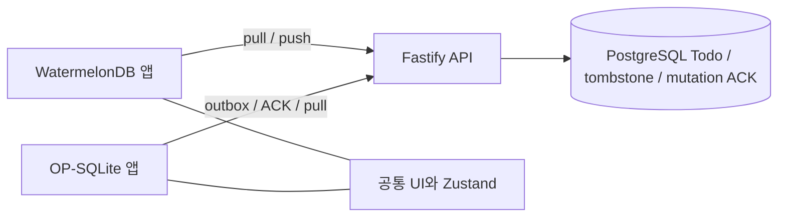

# 자체 동기화 서버와 두 앱의 저장·복원

## 실행

PostgreSQL 17과 Node.js 22.20 이상을 사용한다. 저장소 루트에서 실행한다.

```sh
pnpm install --frozen-lockfile
pnpm db:up
# 별도 터미널: 이 값을 두 앱의 인증 토큰에도 입력한다.
export SYNC_TOKEN="$(openssl rand -hex 24)"
printf '%s\n' "$SYNC_TOKEN"
pnpm run server
```

서버는 기본 `127.0.0.1:3000`, DB는 `127.0.0.1:54329`를 사용한다. `DATABASE_URL`, `HOST`, `PORT`, `SYNC_TOKEN`으로 변경한다. `.env.example`은 변수 예시이며 자동으로 읽지 않는다. `pnpm server`는 pnpm 내장 명령과 겹치므로 **`pnpm run server`** 를 사용한다.

`pnpm db:up`은 Docker Compose 플러그인 또는 `docker-compose`를 사용한다. Colima 환경에 존재하지 않는 Docker Desktop credential helper가 설정된 경우 Docker 설정을 해당 설치에 맞게 수정해야 한다. PostgreSQL 데이터는 `todo-postgres` named volume에 보존한다. `down -v`는 데이터를 삭제하므로 일반 중지에 사용하지 않는다.

각 앱의 **서버 설정**에 URL과 같은 토큰을 입력한 다음 **서버 저장·복원**을 누른다.

- Android emulator: `http://10.0.2.2:3000`
- iOS simulator: `http://localhost:3000`
- 실제 기기: 서버에 접근 가능한 HTTPS 주소. 로컬 LAN 테스트는 서버를 `HOST=0.0.0.0`으로 실행하고 호스트 IP를 사용한다.
- URL과 토큰은 UI 메모리에만 유지한다. 프로세스를 다시 시작하면 다시 입력한다. 토큰을 디스크에 평문으로 저장하지 않는다.
- 로컬 CRUD에는 서버 연결이 필요 없다. 수동 동기화이며 백그라운드·자동 재시도는 아직 없다. 연결 실패 시 변경을 유지하므로 연결 회복 후 같은 버튼을 누른다.
- 새 앱 DB에서 같은 서버에 연결하면 서버에 저장된 Todo가 복원된다. 기존 DB에서는 양방향 동기화하며 전체 DB를 지우거나 과거 백업 시점으로 되돌리지 않는다.

## 현재 범위

`apps/sync-server`는 Fastify 5 + `pg` + PostgreSQL을 사용한다. 작은 스키마의 트랜잭션과 행 잠금을 명확히 하기 위해 SQL을 직접 사용한다. Drizzle은 설치하지 않았다. 이것은 **단일 사용자/단일 공유 데이터 공간** 서버다. 하나의 bearer token으로 두 앱이 같은 데이터에 접근한다. 회원가입·사용자별 권한 분리·토큰 갱신은 구현하지 않았다. 토큰 변경은 같은 데이터 공간의 키 교체이다.

프로덕션 공개 전에는 HTTPS reverse proxy, 요청 제한, 사용자 인증/테넌트 분리, 백업과 모니터링을 운영 환경에 맞게 추가해야 한다. Compose의 기본 DB 암호는 로컬 개발용이며 DB 포트는 loopback에만 노출한다. API는 16자 미만 토큰으로 시작하지 않으며 모든 endpoint에서 인증한다.

## 동기화 계약



서버의 `sync_state` 한 행을 모든 읽기·쓰기 트랜잭션에서 `FOR UPDATE`로 잠근다. 변경은 이 잠금 안에서 cursor를 증가시키고 commit한다. 따라서 Watermelon `timestamp`와 OP `cursor`는 클라이언트 시계가 아닌 **commit 순서의 revision**이다. pull 결과와 cursor는 같은 snapshot에서 나온다. 규모가 작은 단일 사용자 구현의 단순성을 선택했으며 대규모 서비스에서는 사용자별 잠금과 pagination이 필요하다.

| Endpoint | 내용 |
| --- | --- |
| `GET /info` | protocol 1, 서버 epoch |
| `POST /watermelon/pull` | epoch, cursor, schemaVersion 1 → changes + timestamp |
| `POST /watermelon/push` | epoch, cursor, changes → 전체 변경을 원자적으로 적용 |
| `POST /op/pull` | epoch, cursor → 현재 row/tombstone과 version, 새 cursor |
| `POST /op/push` | epoch, mutationId, id, baseVersion, record/null → ACK 또는 conflict/current |

Watermelon은 공식 `synchronize()`를 사용한다. 서버는 생성/수정/삭제를 구분한다. pull 이후 다른 클라이언트가 수정하면 push 전체를 409로 거부하고 클라이언트는 한 번 다시 pull한다. Watermelon의 기본 컬럼 단위 병합 규칙을 사용한다. 동일 컬럼에서는 로컬 변경이 우선하며 서버 삭제는 로컬 수정보다 우선한다.

OP-SQLite는 v2 마이그레이션으로 `dirty`, `deleted`, `server_version`, `local_seq`, `outbox`, `sync_meta`를 추가한다. v1 Todo는 그대로 보존하고 pending create로 전환한다. 전송 전 각 entity의 변경을 하나의 immutable mutation으로 고정한다. 그 뒤 수정은 `local_seq`를 증가시키고 별도의 후속 변경으로 남는다. 서버는 mutation payload와 ACK를 같은 트랜잭션에 기록하므로 응답 유실 후 같은 mutation을 다시 보내도 중복 적용하지 않는다. ACK는 해당 mutation만 제거하고 그 사이 생긴 수정은 dirty로 남긴다. 후속 변경은 다시 동기화하면 전송한다.

OP 충돌은 자동 덮어쓰기하지 않는다. **기기 변경 유지**는 현재 서버 version을 기준으로 다음 mutation을 준비한다. 안내에 따라 다시 동기화하여 전송한다. **서버 변경 사용**은 확인 후 충돌한 snapshot을 서버 값으로 바꾼다. 전송 중 생긴 더 새로운 로컬 변경은 이 선택에도 보존한다. 두 선택 모두 충돌한 항목에 적용하며, 충돌 없는 변경은 정상 처리한다. pull은 dirty row를 건드리지 않고 변경과 cursor를 한 SQLite 트랜잭션에 저장한다.

mutation ACK와 tombstone은 현재 무기한 보관한다. 임의 삭제하면 오랫동안 오프라인이었던 클라이언트의 중복 방지·삭제 전파가 깨질 수 있다.

## 서버 변경과 백업 복구

각 로컬 DB는 최초 접속 시 `[서버 URL, epoch]`에 묶인다. 다른 URL이나 새 epoch는 412로 중단하며 로컬 변경은 유지한다. 이는 다른 서버로 pending Todo를 실수로 보내는 것을 방지한다. 계정 전환 UI와 자동 재초기화는 아직 없다.

서버 프로세스나 PostgreSQL 컨테이너 재시작은 epoch를 유지한다. 서버 DB 전체를 새로 만들면 새 epoch가 생성된다. 과거 DB 백업 복구는 **API를 중지한 상태에서 epoch도 새 UUID로 교체**해야 한다. 그렇지 않으면 백업 이후 변경을 이미 본 클라이언트의 cursor를 안전하게 판별할 수 없다. 복구 후 기존 앱 DB는 자동 덮어쓰기하지 않고 412로 중단된다. 미전송 데이터를 별도로 보존·조정한 후 새 앱 DB로 서버의 현재 상태를 가져오는 운영 절차가 필요하다. 자동 백업/클라이언트 내보내기 도구는 포함하지 않는다.

## 검증

```sh
pnpm db:up
pnpm check
```

서버 테스트는 실제 PostgreSQL에 무작위 임시 schema를 만들어 실행하고 해당 schema만 제거한다. `TEST_DATABASE_URL`로 전용 테스트 DB를 지정할 수 있다. PostgreSQL이 실행 중이어야 한다.

- 서버: 인증·입력 검증, epoch/cursor, 두 프로토콜 교환, lost ACK replay, 동시 수정 충돌, Watermelon batch 원자성, 삭제, API 재시작 후 복원.
- OP repository: 실제 SQLite 엔진으로 v1 migration, immutable 재시도, 전송 중 수정 보존, 명시적 충돌 처리, data/cursor rollback. 이 테스트의 드라이버 shim은 네이티브 검증을 대체하지 않는다.
- Android: 두 Metro와 서버를 실행하고 설치된 두 앱을 disposable emulator에서 검증한다. 아래 명령은 두 앱의 데이터를 의도적으로 초기화한다.

```sh
SYNC_TOKEN="서버와 같은 토큰" python3 scripts/verify-sync-android.py emulator-5580 --reset-app-data
```

스크립트는 Watermelon → 서버 → OP, OP → 서버 → Watermelon, 양쪽 DB 초기화 후 서버 복원, 삭제 전파를 검증한다. 실제 기기 serial은 거부한다. iOS는 Xcode 플랫폼 설치 제약으로 실행 검증하지 않았다.

2026-10-13 결과: `pnpm check`의 린트·타입 검사와 테스트 22개 통과. Android 36 arm64에서 양쪽 앱의 서버 저장·교차 복원·새 로컬 DB 복원·삭제 전파 통과. 두 iOS production JS 번들 생성 통과.

## 참고

- [WatermelonDB 공식 backend 계약](https://watermelondb.dev/docs/Sync/Backend)
- [WatermelonDB frontend 동기화](https://watermelondb.dev/docs/Sync/Frontend)
- [node-postgres transaction: 같은 client 사용](https://node-postgres.com/features/transactions)
