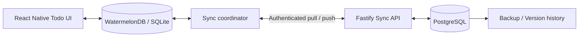

# Offline-first Todo 기술 스택 검토 및 추천

> 최신 구현 상태: 사용자 요청에 따라 `apps/watermelon`과 `apps/op-sqlite` 두 앱을 병행 구성했다. 공통 UI와 Zustand 상태관리는 `packages/todo-app`, Todo 타입과 Repository 계약은 `packages/shared`에 있다. Fastify + PostgreSQL 자체 서버와 양쪽 앱의 수동 서버 저장·복원을 구현했다. Watermelon 기본 계약과 OP 자체 outbox 계약을 병행한다. 실제 동기화 범위·단일 사용자 인증·운영 제한은 [동기화 서버](sync-server.md)를 따른다. Drizzle/MMKV/Keychain은 설치하지 않았다. 아래 추천·대체 경로와 동기화 계약은 설계 검토 기록이며 실제 설치·실행 범위는 [README](../README.md)를 따른다.

조사일: 2026-10-13  
검토 반영일: 2026-10-13  
상태: 추천안 / 네이티브 검증 조건부. 아래 패키지의 설치 또는 조합별 동작 검증 완료를 의미하지 않는다.  
관련 문서: [OP-SQLite 로컬 DB 설계 (대안)](local-database-op-sqlite.md)

확정된 전제:

- **서버는 직접 운영한다.** (2026-10-13 확정) 관리형 BaaS를 주 저장소로 쓰는 구성은 1차 후보에서 제외한다.

## 1. 추천 결론

**React Native Community CLI + TypeScript + pnpm workspace + WatermelonDB + 독립 Fastify 동기화 API + PostgreSQL** 조합을 우선 추천한다. 서버 DB 접근에는 Drizzle ORM을 사용한다.

이 선택은 다음 요구를 우선한다는 가정에 따른 판단이다.

- 인터넷 없이 Todo를 조회·추가·수정·완료·삭제할 수 있다.
- 앱을 다시 시작해도 로컬 변경이 유지된다.
- 연결이 복구되면 여러 기기와 서버에 변경을 반영한다.
- 로그인한 사용자가 새 기기에서 서버에 저장된 현재 데이터를 복원한다.
- 로컬 데이터 모델과 서버 운영 방식을 직접 통제한다.

서버를 직접 운영하기로 했으므로 RNFirebase + Firestore 단독 구성은 1차 후보에서 제외한다. 서버 운영 결정이 바뀌어 출시 속도가 최우선이 되면 다시 검토한다. 동기화 서버를 직접 구현할 여력이 부족하면 PowerSync를 검토한다. PowerSync Service는 Docker로 직접 운영할 수 있다(3장 PowerSync 절).

### 1.1 검증 실패 시 대체 경로

환경을 정상화한 뒤에도 WatermelonDB 네이티브 호환성 문제가 재현되면 **경로 A: WatermelonDB 계약을 유지하는 OP-SQLite 클라이언트**를 기본 대체안으로 검토한다. 저장 드라이버만 바꾸는 작업은 아니며 변경 추적과 동기화 클라이언트를 새로 구현해야 한다.

| 경로 | 서버 계약 | 클라이언트 변경 | 선택 조건 |
| --- | --- | --- | --- |
| A: 호환 클라이언트 (기본 대안) | WatermelonDB pull/push 계약 유지 | OP-SQLite 위에 변경 추적, pull 후 push, 필드별 병합과 로컬 변경 보존 구현 | 기본 충돌 정책을 수용하고 네이티브 adapter만 대체하려는 경우 |
| B: 자체 SyncEngine (별도 설계 선택) | mutation별 ACK·버전 검사·충돌 보존 계약으로 변경 | outbox, ACK, 재시도, 충돌 해결을 직접 구현 | 명시적인 충돌 보존·사용자 해결 등이 제품 필수 요구인 경우 |

- 화면 코드는 Repository/훅을 거치게 하여 교체 범위를 줄인다. 경로 A도 서버·클라이언트 계약 테스트를 통과해야 하며 기존 서버와 자동으로 호환된다고 가정하지 않는다.
- [OP-SQLite 설계 문서](local-database-op-sqlite.md)의 4~9장 및 mutation 관련 테스트는 **경로 B의 상세안**이다. 이를 경로 A에 그대로 적용하지 않는다. 경로 A의 구체적인 변경 추적·병합 설계는 전환 결정 시 별도로 작성한다.
- 서버가 아직 없더라도 경로 B를 자동 선택하지 않는다. 충돌 정책과 유지보수 비용을 기준으로 선택하고, 경로 B를 택하면 서버 계약 변경을 설계 결정으로 기록한다.

## 2. 권장 구성과 선정 이유

| 계층 | 제안 | 선정 이유 / 경계 |
| --- | --- | --- |
| 모바일 | React Native Community CLI + TypeScript | 사용자 지정 조건. iOS/Android 네이티브 프로젝트를 직접 관리한다. |
| 저장소 구성 | pnpm workspace | 사용자 지정 조건. 모바일·서버·공유 계약을 하나의 저장소에서 관리한다. |
| 로컬 데이터 | WatermelonDB, SQLite adapter | 로컬 데이터를 중심으로 UI를 구성하고, 변경 추적 및 기존 동기화 프로토콜을 활용한다. |
| 동기화 | WatermelonDB `synchronize()` + 자체 pull/push API | 독자 동기화 엔진 전체를 작성하는 부담을 줄이면서 서버를 통제한다. |
| API | Node.js + Fastify + TypeScript | 작은 동기화 API부터 시작하고, 요청 검증·인증·로깅을 서버 경계에 모은다. |
| 서버 DB | PostgreSQL | Todo, 사용자, 삭제 이력과 동기화 버전을 트랜잭션으로 관리하는 설계를 채택한다. |
| 서버 DB 접근 | Drizzle ORM + PostgreSQL driver | SQL 구조를 명시적으로 유지한다. Drizzle은 서버에서만 사용하고 WatermelonDB 모델을 대체하지 않는다. |
| 공유 패키지 | DTO, 계약 검증, 순수 도메인 로직 | 네이티브 모듈이나 서버 DB 모델을 무리하게 공유하지 않는다. |
| UI 상태 | React state/context 우선 | Todo 데이터의 원본은 로컬 DB로 유지하고, 화면 필터·선택 상태만 별도로 둔다. |

WatermelonDB를 선택할 때 받아들이는 비용도 명시한다.

- 데이터 접근이 WatermelonDB 모델·쿼리 API에 묶인다. 원시 SQL, FTS 같은 SQLite 기능을 쓰는 범위는 adapter가 허용하는 만큼으로 제한된다.
- 모델 정의에 decorator를 쓰므로 Babel(legacy decorators)과 TypeScript 설정이 필요하다.
- 네이티브 adapter 유지보수를 외부 프로젝트에 의존한다. 2026-10 기준 최신 릴리스는 2025-04의 0.28이고, New Architecture bridgeless 지원은 공식 발표 없이 커뮤니티 보고에 기대고 있다(8장 1단계). RN 업그레이드마다 호환 여부를 먼저 확인해야 한다.

WatermelonDB는 로컬 DB이며, 변경 추적과 동기화 어댑터를 제공하지만 백엔드는 직접 구현해야 한다. Fastify는 스키마 기반 API 구현 기능을 제공하며, Drizzle은 PostgreSQL 드라이버를 지원한다. 위 조합의 적합성은 이 기능들을 요구사항에 맞춰 평가한 설계 판단이다. [WatermelonDB Sync](https://watermelondb.dev/docs/Sync/Intro), [Fastify](https://fastify.dev/docs/latest/), [Drizzle PostgreSQL](https://orm.drizzle.team/docs/get-started-postgresql)

## 3. 대안 비교

| 구성 | 적합한 경우 | 구현·운영 부담 | 이번 판단 |
| --- | --- | --- | --- |
| WatermelonDB + 자체 API + PostgreSQL | 전체 로컬 데이터와 명시적 동기화 정책을 통제해야 할 때 | 서버 프로토콜, 충돌, 삭제, 마이그레이션을 직접 운영 | 우선 추천, 네이티브 호환성 검증 조건 |
| RNFirebase + Firestore | 단순한 개인 Todo를 빠르게 출시하고 싶을 때 | 캐시 범위, Security Rules, 쿼리와 비용 관리 필요 | 서버 직접 운영 결정으로 1차 후보 제외 |
| PowerSync + SQLite + PostgreSQL | 로컬 SQL을 유지하면서 내려받기 동기화 구현 부담을 줄일 때 | PowerSync 서비스(또는 self-host) 운영과 업로드 API 필요 | 동기화 서버 구현 부담이 클 때 대안 |
| OP-SQLite + 자체 동기화 | SQL과 동기화 정책을 모두 직접 설계해야 할 때 | 변경 큐·충돌·재시도·복구를 직접 구현 | WatermelonDB 검증 실패 시 1순위 대체안 (1.1절) |

WatermelonDB도 내부적으로 SQLite를 쓴다. 따라서 WatermelonDB와 OP-SQLite의 실제 차이는 "SQL을 쓰느냐"가 아니라 **변경 추적과 동기화 클라이언트를 라이브러리에 맡기느냐, 직접 만드느냐**이다.

### Firestore를 선택하는 경우

React Native에서는 `@react-native-firebase/app`과 `@react-native-firebase/firestore`를 통한 iOS/Android 네이티브 SDK 구성을 검토한다. 네이티브 영속성과 웹 SDK 설정은 구분해야 한다. [RNFirebase Firestore](https://rnfirebase.io/firestore/usage)

Firestore는 오프라인 캐시의 읽기·쓰기와 재연결 시 동기화를 지원한다. 다만 캐시는 앱이 받은 데이터를 중심으로 동작하므로 모든 서버 문서가 언제나 오프라인에서 존재한다고 가정하면 안 된다. 같은 문서의 여러 변경에는 last-write-wins 동작이 적용된다. 캐시 정책과 대상 쿼리의 초기 로딩 완료 여부를 제품 요구에 맞춰 확인해야 한다. [Firestore 오프라인 지원](https://firebase.google.com/docs/firestore/manage-data/enable-offline)

Firestore를 주 저장소로 선택하면 SDK의 오프라인 기능부터 사용한다. WatermelonDB를 함께 두면 두 저장소 사이의 변경 큐, 충돌 처리, 성공 판정을 연결하는 별도 계층이 필요하다. Firestore를 자체 API 뒤의 서버 DB로 쓰는 것은 가능하지만, WatermelonDB pull/push 계약을 대신 구현해 주지는 않는다. 초기 버전에는 이중 동기화 구조를 권하지 않는다. 이는 두 제품의 동기화 경계를 고려한 설계 판단이다. [WatermelonDB의 백엔드 요구](https://watermelondb.dev/docs/Sync/Intro)

### PowerSync를 선택하는 경우

PowerSync는 React Native SDK와 로컬 SQLite 기반 구성을 제공한다. 클라이언트 변경은 업로드 큐에 들어가며, 개발자가 `uploadData()`와 서버 쓰기 API를 연결해야 한다. 따라서 자체 쓰기 검증·권한·충돌 정책까지 모두 없어지는 제품은 아니다. [React Native SDK](https://docs.powersync.com/client-sdks/reference/react-native-and-expo), [Writing Data](https://docs.powersync.com/client-sdks/writing-data)

직접 운영 조건 (2026-10-13 확인):

- PowerSync Service는 Docker 이미지(`journeyapps/powersync-service`)로 직접 운영할 수 있다. 직접 운영 시에는 PowerSync Dashboard를 쓸 수 없다. 별도 지원과 추가 기능이 필요하면 유료 Enterprise Self-Hosted Edition이 있다. [Self-hosting](https://docs.powersync.com/self-hosting/getting-started)
- 서비스 저장소의 라이선스는 **FSL-1.1-ALv2 (Functional Source License)**이다. PowerSync와 같거나 비슷한 기능을 다른 사람에게 상용 제품·서비스로 제공하는 "Competing Use"를 금지하며, 각 버전은 공개 2년 후 Apache 2.0으로 전환된다. 자체 앱의 동기화 서버로 쓰는 것은 금지 대상에 해당하지 않는 것으로 읽히지만, 도입 전에 법무 검토로 확정한다. [LICENSE](https://github.com/powersync-ja/powersync-service/blob/main/LICENSE)
- 저장소 README는 Postgres, MongoDB, MySQL, SQL Server 등을 원본 DB로 지원한다고 밝힌다. 이 문서의 PostgreSQL 선택과 맞는다. [powersync-service](https://github.com/powersync-ja/powersync-service)

직접 pull 프로토콜을 구현하는 비용과 PowerSync 서비스를 직접 운영하는 비용을 비교한 뒤 선택한다. 선택 시 현재 SDK의 SQLite adapter 및 RN 버전 요구사항도 함께 검증한다.

### OP-SQLite를 선택하는 경우

OP-SQLite는 React Native용 SQLite 접근 계층이다. 공식 설치 문서에는 최소 RN 버전이나 New Architecture 지원 여부가 적혀 있지 않다(2026-10-13 확인). 대체안으로 전환할 때 저장소의 peer dependency와 변경 내역으로 RN 0.87.1 지원을 따로 확인한다. 모노레포에서는 `op-sqlite` 설정을 루트 `package.json`에 둔다. [OP-SQLite 설치](https://op-engineering.github.io/op-sqlite/docs/installation) 이 구성에서 서버 동기화는 별도 설계 대상으로 둔다. SQL 제어가 핵심 요구가 아니라면 Todo 초기 버전에서 변경 추적까지 새로 구현할 이점은 작다고 판단한다. [OP-SQLite 공식 문서](https://op-engineering.github.io/op-sqlite/)

## 4. 권장 데이터 흐름

아래 내용은 구현할 동작의 제안이다.

1. 모든 Todo 화면은 로컬 DB를 읽는다. 작성 결과는 로컬 트랜잭션 완료 후 즉시 보여준다.
2. 저장 성공과 서버 동기화 성공을 구분한다. 동기화 대기·실패·마지막 성공 시각을 확인할 수 있게 한다.
3. 앱 시작, foreground 복귀, 네트워크 복구, 사용자 새로고침 때 동기화를 요청한다. 같은 DB의 동기화는 직렬화한다.
4. 실패 시 로컬 변경을 유지하고 지수 backoff와 jitter로 재시도한다. 네트워크 연결 이벤트는 서버 도달 가능성을 보장하지 않으므로 요청 실패도 처리한다.
5. 모바일 OS의 background 실행 제한을 고려하여, 앱이 종료된 동안 반드시 즉시 동기화된다고 약속하지 않는다.

WatermelonDB 기본 동기화는 **pull 후 push** 순서이며, 변경된 필드를 추적한다. 충돌은 기본적으로 **per-column client-wins** 방식이다. 서버 값을 가져오되 마지막 동기화 이후 로컬에서 변경한 필드는 로컬 값을 유지한다. 클라이언트 시각이 가장 최신인 레코드를 선택하는 정책과 다르다. [Sync implementation](https://watermelondb.dev/docs/Implementation/SyncImpl)

예를 들어 다른 기기에서 제목을 수정하고 현재 기기에서 완료 여부를 수정했다면 각 필드의 변경을 보존할 수 있다. 실시간 공동 편집용 CRDT와 같은 보장을 전제하지 않는다.

수정과 삭제가 겹칠 때의 기본 동작도 비대칭이다. 공식 구현 문서 기준으로 (2026-10-13 확인):

- 로컬에서 삭제한 레코드에 원격 수정이 오면 원격 수정을 무시하고, 나중에 삭제를 push한다.
- 원격에서 삭제된 레코드는 로컬에서 수정했더라도 삭제한다("if locally changed, destroy anyway"). **이 경우 로컬 수정은 알림 없이 사라진다.** 제품에서 받아들일 수 없다면 아래 제품 결정에 포함한다.

예를 들어 A가 제목을 push한 뒤 B가 로컬에서 편집한 같은 제목을 유지하며 pull/push를 완료하면 서버에는 B의 값이 남는다. A도 이후 pull하고 추가 로컬 변경이 없다면 B의 값을 받는다. 이 과정에서 A의 값이 별도 충돌 UI 없이 대체될 수 있다.

**구현 전 제품 결정:** 기본 per-column client-wins를 수용할지 먼저 정한다. 수용하지 않는 필드가 있으면 편집 기준값/버전과 변경 필드 보존, 충돌 저장·해결 흐름을 포함하는 클라이언트·서버 확장 계약을 설계하거나 경로 B를 선택한다. 이 결정은 아직 확정되지 않았다.

서버의 `lastPulledAt` 검사는 pull 이후 발생한 서버 변경을 감지한다. B가 A의 변경을 이미 pull한 뒤 자신의 값을 push하는 경우에는 그 검사만으로 편집 시점의 충돌을 식별할 수 없다. 서버 push에서 무조건 거부하는 정책만 추가하면 재시도가 반복될 수 있으므로, 해결 가능한 클라이언트 상태 전이와 함께 설계해야 한다. [WatermelonDB 백엔드 계약](https://watermelondb.dev/docs/Sync/Backend)

## 5. 동기화 API 설계 초안

경로명은 제안이며, WatermelonDB 어댑터와 서버 사이에서 다음 계약을 맞춘다.

| 엔드포인트 | 요청 / 응답 개념 |
| --- | --- |
| `POST /sync/pull` | `lastPulledAt`, `schemaVersion`, `migration` → 테이블별 `created`, `updated`, `deleted` 및 서버 `timestamp` |
| `POST /sync/push` | `changes`, `lastPulledAt` → 전체 변경의 트랜잭션 성공 또는 재동기화가 필요한 오류 |

WatermelonDB 예시는 pull에 `GET`을 쓰지만, 이 문서는 `POST`를 제안한다. 요청에 스키마 버전과 마이그레이션 정보를 함께 보내고, 중간 프록시나 HTTP 캐시가 응답을 저장하지 않게 하기 위해서다. 응답에는 `Cache-Control: no-store`를 둔다.

공식 프로토콜은 최초 pull에서 접근 가능한 전체 데이터 반환, 일관된 변경 조회, 삭제 ID 전달, 원자적 push, 중복 요청 처리와 pull 이후 서버에서 바뀐 레코드의 push 거부를 요구한다. 이를 일반 CRUD API 몇 개로 대체하면 동일한 동기화 보장을 얻지 못한다. [Backend contract](https://watermelondb.dev/docs/Sync/Backend)

구현 시 다음 정책을 추가로 명세한다.

- **사용자 범위:** 토큰을 검증한 서버가 사용자 ID를 결정한다. 클라이언트가 보낸 소유자 ID를 권한 근거로 사용하지 않는다.
- **일관된 커서:** 서버가 발급한 커서만 사용한다. 시계값이나 sequence 할당 순서가 commit 순서와 다르면 변경이 누락될 수 있으므로, 쓰기 직렬화/잠금과 일관된 snapshot 등 검증된 방식으로 경계를 보장한다.
- **삭제 이력:** `deleted_at` 또는 tombstone 테이블을 유지한다. 장기간 오프라인 기기도 삭제를 전달받을 수 있어야 한다.
- **오래된 커서:** tombstone 보존 기간을 초과한 기기는 전체 재동기화 대상으로 처리한다. 먼저 미동기화 로컬 변경을 보호한다.
- **멱등성:** 같은 push를 다시 보내도 중복 Todo가 생기지 않아야 한다. 추가 부수 효과가 있다면 요청 ID 기반 중복 방지도 적용한다.
- **계정 전환:** 계정별 DB 분리 또는 명시적 정리 절차를 둔다. 이전 계정의 미동기화 변경을 새 계정에 업로드하지 않는다.
- **마이그레이션:** 로컬 스키마와 서버 계약 버전을 따로 관리하고 구버전 앱의 동기화를 검증한다.

이 목록은 공식 계약을 구현하고 운영하기 위한 프로젝트 설계 제안이다. 커서와 삭제 보존 정책은 서버 구현 전에 확정해야 한다.

클라이언트 쪽에서 함께 정할 사항:

- **동기화 옵션:** `synchronize()`의 `sendCreatedAsUpdated`, 최초 대량 동기화용 `unsafeTurbo` 사용 여부를 정한다. `unsafeTurbo`는 최초 동기화에만 쓰는 제약이 있으므로 공식 문서의 조건을 확인한 뒤 채택한다.
- **트리거 구현:** 네트워크 상태 감지에는 `@react-native-community/netinfo`, foreground 복귀에는 RN `AppState`를 쓴다. background 작업 라이브러리는 4장 5항의 제약을 받아들인 뒤 보조 수단으로만 검토한다.

## 6. 저장·복원과 백업 구분

- **새 기기 복원:** 로그인 후 최초 전체 pull로 서버에 저장된 현재 상태를 로컬 DB에 구성한다.
- **동기화:** 현재 상태를 기기 간에 맞춘다. 잘못된 삭제나 수정도 다른 기기로 전달될 수 있다.
- **과거 상태 복원:** 별도의 버전 이력, 사용자 스냅샷 또는 서버 백업 정책이 필요하다. 제품 기능으로 제공하려면 복원 API와 충돌 정책도 정의한다.
- **미업로드 데이터:** 서버에 전달되지 않은 로컬 변경은 서버에서 복원할 수 없다. 앱 삭제·기기 분실 전에 동기화되지 않은 변경은 이 서버 복원 기능의 대상이 아니다.

첫 버전의 복원 범위는 **서버에 성공적으로 동기화된 현재 Todo 복원**으로 제한하고, 시점 복원은 별도 기능으로 명세하는 것을 권장한다.

### 6.1 서버 백업 복원 후 동기화 (제안 계약)

서버를 과거 백업으로 되돌리는 경우는 새 기기 복원과 별도로 처리한다. 서버 구현·운영 전에 다음 절차와 복구 목표를 확정한다.

- 복원 후 트래픽을 재개하기 전에 새로운 `sync_epoch`를 발급한다. 백업의 이전 값을 그대로 재사용하지 않는다. epoch 변경과 서버 복원은 운영 절차로 연결한다.
- 모든 pull/push 요청·응답에 epoch를 포함한다. WatermelonDB의 숫자형 `lastPulledAt`는 유지하고 epoch는 HTTP 계약의 별도 필드로 전달하며, 앱 coordinator가 로컬 메타데이터에 관리한다. epoch는 WatermelonDB 기본 제공 기능으로 가정하지 않는다.
- 서버는 기존 epoch의 push를 적용하기 전에 복구 필요 응답을 반환한다. 클라이언트는 이전 커서·진행 중 요청·늦은 응답을 새 epoch에 적용하지 않고 일반 동기화를 중단한다.
- 로컬 DB와 미동기화 의도를 보존한 뒤 서버 snapshot과 비교·재조정한다. 단순 DB 삭제나 커서 초기화로 끝내지 않는다. 비교 완료 후 새 epoch의 동기화 상태를 원자적으로 활성화한다.
- 이미 ACK되어 로컬 변경 추적에서도 제거된 쓰기는 재전송할 정보가 없을 수 있다. epoch만으로 복구할 수 없으며 서버 백업·변경 로그 보존과 복구 가능 시점(RPO), 복구 시간 목표(RTO)를 정해야 한다. 로컬 snapshot은 복구 후보로 보존하되 서버 삭제를 되살릴 수 있으므로 자동 업로드하지 않는다.
- 서버 백업 복원, ACK된 쓰기 손실, 미확정 push, 오래된 기기 복귀와 epoch 전환 중 앱 종료를 운영 전 통합 테스트에 포함한다.

## 7. 모노레포 배치 제안

| 경로 | 책임 |
| --- | --- |
| `apps/watermelon` | Community CLI 앱, 네이티브 프로젝트, WatermelonDB 모델·마이그레이션, UI, 동기화 coordinator |
| `apps/api` | Fastify 서버, 인증·권한 검사, pull/push, Drizzle 모델·서버 마이그레이션 |
| `packages/contracts` | 동기화 DTO와 런타임 검증 규칙 |
| `packages/domain` | Todo 도메인의 플랫폼 독립 타입·순수 함수 |
| `packages/typescript-config` | 필요한 경우 공통 TypeScript 설정 |
| `docs` | 조사, 설계 결정, 동기화 계약 |

현재 저장소에는 `packages/shared`(`@offline-first/shared`)만 있다. 처음에는 `packages/shared` 안에 `contracts`와 `domain` 모듈을 두고, 서버 앱이 생겨 의존 방향을 분리할 필요가 생기면 별도 패키지로 나눈다.

이 표는 목표 구조이며 모든 디렉터리가 이미 만들어졌다는 뜻은 아니다. pnpm workspace부터 시작하고, 빌드 그래프·캐시 요구가 생기면 작업 실행 도구를 추가한다. 모바일 DB 모델과 서버 ORM 모델은 각 앱에서 관리한다.

## 8. 구현 전 검증 및 도입 순서

현재 프로젝트의 **React Native 0.87.1과 후보 DB 라이브러리의 조합은 아직 검증되지 않았다.** 문서상 기능 지원과 해당 버전의 iOS/Android 빌드 성공은 별개다. React Native 버전 숫자만으로 네이티브 DB 호환성을 확정하지 않는다.

1. **네이티브 검증 (spike, 1일 내외):** pnpm 환경의 Metro 해석·autolinking, iOS CocoaPods, Android Gradle, New Architecture에서 WatermelonDB SQLite adapter를 빌드한다. 앱 종료 후 데이터 유지까지 확인한다. 특히 다음 항목을 확인한다.
   - JSI adapter(`jsi: true`)가 RN 0.87의 bridgeless 환경에서 초기화되는지
   - Android JSI 설치 안내가 현재 Kotlin `MainApplication` 템플릿에 맞는지
   - decorator용 Babel 설정이 RN 0.87 기본 Babel preset과 충돌하지 않는지
   - Android ProGuard/R8 release 빌드에서 JSI 모듈이 제거되지 않는지

   2026-10-13에 확인한 WatermelonDB 지원 현황:

   - 최신 릴리스는 **0.28 (2025-04-07)**이다. 변경 내역에 "Support for React Native 0.74+"가 있고, Android JSI 설치 방식이 바뀌었다. `MainApplication`의 `getJSIModulePackage()` override를 지우고 `getPackages()`에 `WatermelonDBJSIPackage()`를 추가한다. 그 이전 릴리스는 0.27.1 (2023-10-15)이다. [CHANGELOG](https://github.com/Nozbe/WatermelonDB/blob/master/CHANGELOG.md)
   - New Architecture bridgeless 지원 이슈 [#1769](https://github.com/Nozbe/WatermelonDB/issues/1769)는 2024-04 생성 이후 **열려 있다.** 관리자의 공식 지원 발표는 없다.
   - 같은 이슈에서 사용자들은 0.28.0이 RN 0.81~0.83 New Architecture에서 동작한다고 보고했다. 다만 수동 설정이 필요했다. 보고된 설정은 `settings.gradle`에 `node_modules/@nozbe/watermelondb/native/android-jsi`를 `:watermelondb-jsi`로 포함, `app/build.gradle`에 `implementation project(':watermelondb-jsi')` 추가, `getPackages()`에 `WatermelonDBJSIPackage()` 등록, ProGuard 규칙 `-keep class com.nozbe.watermelondb.** { *; }` 추가이다. 같은 설정에서 Android `initializeJSI` null 오류나 Gradle task 의존성 오류를 겪었다는 보고도 있다.
   - RN 0.84 이후, 특히 이 프로젝트의 0.87.1에서 동작했다는 보고는 찾지 못했다.
   - 이슈 [#1969](https://github.com/Nozbe/WatermelonDB/issues/1969)(2026-06 생성, 열림)에서 한 기여자가 TypeScript와 Nitro Modules로 다시 작성한 별도 프로젝트(NitromelonDB)를 예고했다(2026-08). WatermelonDB 본체의 공식 계획은 아니며, 이 문서의 후보로 삼지 않는다.

   따라서 New Architecture 지원은 **공식 보장이 아니라 커뮤니티 보고와 수동 설정에 기대는 상태**이다. spike 결과에 사용한 설정과 버전을 기록하고, RN 업그레이드마다 다시 검증한다.

   환경 준비 실패, 조사 미완료, 라이브러리 호환성 실패를 구분한다. Xcode 플랫폼·SDK 누락, 도구 경로, 다운로드 실패는 환경을 복구한 뒤 재검증한다. 현재 확인된 iOS 플랫폼 누락도 WatermelonDB 실패 근거가 아니다. 정상 환경에서 버전·최소 재현·오류 로그를 확보하고 지원 설정/버전으로도 해결되지 않는 호환성 문제가 확인된 경우에만 1.1절의 대체 경로를 검토한다. 1일은 조사 예상치이며 자동 전환 기한이 아니다.
2. **로컬 Todo:** 생성·수정·완료·삭제와 로컬 마이그레이션을 구현한다. 네트워크 없이 실행하고 재시작한다.
3. **단일 계정 동기화:** 최초 전체 pull, 증분 pull, push, tombstone 및 인증 범위를 구현한다.
4. **장애 시나리오:** 서버 commit 후 응답 유실, 중복 push, pull과 push 사이 원격 변경, 동기화 중 로컬 편집을 검증한다.
5. **여러 기기:** 서로 다른 필드/같은 필드 수정, 수정 대 삭제, 장기 오프라인 복귀, 계정 전환을 검증한다.
6. **복원·운영:** 빈 기기 복원, 오래된 커서 처리, 로그·오류 관측과 6.1절의 서버 백업 복원·epoch 전환 훈련을 추가한다.

버전은 이 검증을 통과한 조합으로 고정한다. 초기 의존성 설치를 기술 선정 완료로 간주하지 않고, 로컬 영속성과 두 기기 동기화 검증을 최종 채택 기준으로 삼는다.
